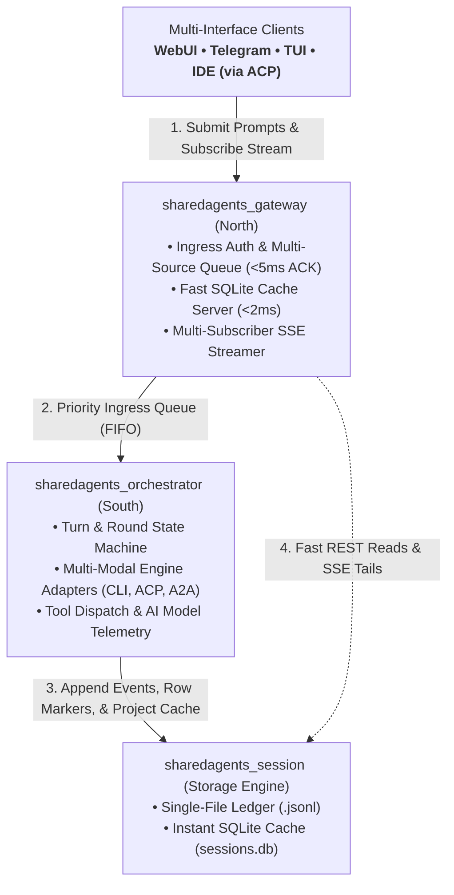

# sharedagents.ai

[](https://pypi.org/project/sharedagents/)
[](https://pypi.org/project/sharedagents/)
[](LICENSE)
[](https://github.com/sharedagents-ai/sharedagents/actions/workflows/ci.yml)
[](https://docs.sharedagents.ai/)
[](https://github.com/astral-sh/ruff)

**SharedAgents is a local AI agent that runs on your own machines — and lets
you see everything under the hood.**

The goal: the ease of a hosted assistant like Grok, but running on
infrastructure you control, with full visibility into how the agent thinks —
every model call, tool invocation, delegation and decision is inspectable in
the TUI, the WebUI, and on disk.

Version 1.0.0 ships the platform: a multi-agent orchestrator with a web UI,
Telegram/WhatsApp channels, voice, MCP tools, pluggable engines (local vLLM,
Claude, Codex, Gemini and more), and deep SharedData integration. The
Grok-style assistant personality arrives in upcoming releases — 1.0.0 is the
transparent agent platform it will be built on.

> **Run it now:** `git clone https://github.com/sharedagents-ai/sharedagents.git && cd sharedagents && ./sharedagents` —
> the launcher creates `.venv/`, installs dependencies, and starts
> the TUI. Or `pip install sharedagents && sharedagents` — the first-run
> wizard walks you through the LLM endpoint and model choice.

## Quickstart

```bash
pip install "sharedagents[web]"
sharedagents                      # first-run wizard: LLM endpoint + model, then the TUI
python -m sharedagents.serve      # orchestrator + gateway + WebUI on http://127.0.0.1:8110
```

Prefer containers? See [With Docker](#with-docker). Full documentation lives at
[docs.sharedagents.ai](https://docs.sharedagents.ai/) (sources under `docs/`, built
with `mkdocs build --strict`).

## Install

```bash
pip install sharedagents
```

That puts a `sharedagents` command on your `PATH`. Run it once with no
arguments — the first-run wizard walks you through the LLM endpoint,
model, and (optionally) Telegram, then brings the gateway up itself.
Three steps and you're in the TUI:

> **`pip install sharedagents` → `sharedagents` → answer the wizard → done.**

Optional extras:

| Install command | What you get |
|---|---|
| `pip install sharedagents` | Lean core — TUI + orchestrator + gateway + MCP client + SQLite storage |
| `pip install sharedagents[full]` | Add PDF/DOCX/YouTube/web-extraction tools |
| `pip install sharedagents[web]` | Add the browser chat frontend (Flask; waitress on Windows, gunicorn on POSIX) |
| `pip install sharedagents[stt]` | Add local Fast Whisper speech-to-text (CPU) |

### From a clone (for development)

`git clone https://github.com/sharedagents-ai/sharedagents.git && cd sharedagents && ./sharedagents` — the launcher creates
`.venv/`, runs an editable `pip install -e .`, and starts the TUI.

## Run the gateway, orchestrator and WebUI together

```bash
pip install "sharedagents[web]"     # the WebUI lives in the [web] extra
python -m sharedagents.serve        # foreground: Ctrl+C stops the whole stack
```

`serve` brings all three components up and prints one line per component:

```text
START orchestrator 8099 pid=1234 http=200
START gateway 8100 pid=1235 http=200
START web 8110 pid=1236 http=200
WebUI http://127.0.0.1:8110  (Ctrl+C stops the stack; --detach keeps it running after this shell exits)
```

| Component | Default address |
|---|---|
| orchestrator | `http://127.0.0.1:8099` |
| gateway | `http://127.0.0.1:8100` |
| WebUI | `http://127.0.0.1:8110` |

```bash
python -m sharedagents.serve --detach   # background; survives the shell closing
python -m sharedagents.serve status     # one PASS/FAIL line per component
python -m sharedagents.serve stop       # shut the stack down
python -m sharedagents.serve --no-web   # backend roles only (no [web] extra needed)
```

The same entry point is installed as the `sharedagents-serve` console script, and
`python -m sharedagents` is an alias. There is deliberately no service supervisor and
no restart loop: a component that dies is reported by name, never respawned.

Inside a source checkout, `sharedagents.bat` / `sharedagents-stop.bat` /
`sharedagents-status.bat` wrap these same three commands for Windows.

### With Docker

```bash
docker compose up --build -d     # WebUI on http://127.0.0.1:8110
docker compose exec sharedagents sharedagents-web --create-user you@example.com
```

The orchestrator and gateway stay on the container's loopback; only the WebUI is
published. State lives in the `sharedagents-data` volume. Set
`SHAREDAGENTS_WEB_PUBLISH` (default `127.0.0.1:8110`) to change the host address.
Behind a reverse proxy, set `SHAREDAGENTS_WEB_TRUSTED_PROXIES` to the address
the container sees for proxied requests (usually the compose network's
gateway, not the proxy's host address) so the login throttle sees real client
IPs; `SECURITY.md` shows how to find it.

Provider keys (for example `DEEPSEEK_API_KEY`) go in a `.env` file next to
`compose.yml`, or in the file `SHAREDAGENTS_ENV_FILE` names; they are read at
start and never baked into the image. A model server on the host (vLLM,
llama.cpp, Ollama) is reachable from the container at
`http://host.docker.internal:<port>/v1`.

## Core Packages

Modular packages under `src/` — installed as `pip install sharedagents`:

| Package | Role |
|---|---|
| `sharedagents_session` | **Storage Engine**: Single-file `<sid>.jsonl` ledger + instant SQLite cache (`sessions.db`) |
| `sharedagents_orchestrator` | **Execution Core**: Turn loop, multi-modal engine adapters (CLI, ACP, A2A), tool dispatch |
| `sharedagents_acp` | **Agent Client Protocol**: JSON-RPC 2.0 IDE server/client (Cursor, Zed, JetBrains) |
| `sharedagents_gateway` | **Edge Membrane**: Auth, Ingress Queue (<5ms ACK), fast REST cache (<2ms), SSE streaming |
| `sharedagents_tui` | **Terminal TUI**: Textual-based interactive terminal interface |
| `sharedagents_web` | **Browser WebUI**: Multi-tab interface (Sessions, Usage, Agent Monitor, Tasks, Loops, Topics, Dev, Goals, Voice, Agent Builder) |
| `sharedagents_realtime` | **Realtime Voice**: WebRTC full-duplex bidirectional audio streaming |
| `sharedagents_telegram` | **Telegram Bot**: Group chat, voice notes, images and documents in, agent files out, remote execution |
| `sharedagents_whatsapp` | **WhatsApp**: Self-chat channel via a linked device — text, voice notes, images, PDF/Markdown/Office documents, agent files out, agent questions |
| `sharedagents_mcp` | **MCP Servers**: Bundled MCP tools (memory, search, filesystem, terminal) |
| `sharedagents_research` | [Foreground knowledge-store research](docs/research-workflow.md), with a typed MCP client and native research profile |

## Extras

- **`[full]`** — trafilatura (web-fetch), markitdown (PDF/DOCX), yt-dlp + youtube-transcript-api (YouTube), imageio-ffmpeg (voice-note transcode)
- **`[web]`** — Flask for the browser chat frontend (waitress on Windows, gunicorn on POSIX)
- **`[stt]`** — faster-whisper (CPU-only STT for Telegram voice)
- **`[bedrock]`** — boto3/botocore for the **native Amazon Bedrock Converse** transport. The tested SDK minimum is 1.43.101; older SDKs fail before client construction. Optional: a non-Bedrock install must never need the AWS SDK.
- **`[realtime]`** — numpy for the realtime voice server (`sharedagents_realtime`) — hands-free wake word also needs `sharedagents web fetch-voice-models` (CC BY-NC-SA models, downloaded on demand; see [docs/voice-models.md](docs/voice-models.md)); without them voice works in push-to-talk
- **`[docs]`** — mkdocs-material to build this documentation site (`mkdocs build`)
- **`[whatsapp]`** — neonize (Go whatsmeow) linked-device transport for `sharedagents_whatsapp`. Needs Python 3.11+ and the system `libmagic1` library.

## WhatsApp (self-chat channel)

Talk to your agent from WhatsApp: sharedagents links to your account as a companion device
(like WhatsApp Web, shown as "sharedagents" under *Linked devices*). You write in your own
"Message yourself" chat and the agent answers in the same chat, including turns that
finish later in the background.

```bash
pip install 'sharedagents[whatsapp]'           # plus: apt install libmagic1
sharedagents whatsapp link                     # scan the QR (also saved as ~/.sharedagents/whatsapp/link-qr.png)
sharedagents whatsapp link --phone +5511...    # or get an 8-character pairing code instead
sharedagents whatsapp install-service          # systemd user unit sharedagents-whatsapp.service
sharedagents whatsapp status
```

In the chat, `/new` starts a fresh session, `/stop` stops a turn, `/agent <name>` switches
agents and `/status` shows the link. Every other `/command` runs in the agent runtime.
Voice notes are transcribed through the `stt` service, and agent questions or permission
prompts are answered by replying with a number.

**Files.** Send an image (as a photo or as a file) and the agent sees it; send a PDF,
Markdown/text or Office document and the agent reads its text (converted with `markitdown`
from the `[full]` extra; up to `max_media_mb`, default 16 MB). When the agent links a file
it made (`[Report](</abs/path/report.pdf>)`, the same contract the web UI uses), the file
follows its answer: PNG/JPEG/WebP as a photo, anything else as a document. Agents can also
queue files with the `whatsapp` skill: `send --file </abs/path/report.pdf> [text]`.
Telegram does the same: images and documents in, the agent's linked files out.

- **Privacy.** The service only reads and writes your self-chat. Other chats are ignored
  and never logged.
- **Credentials.** `~/.sharedagents/whatsapp/neonize.sqlite3` is a live WhatsApp login, stored
  with permissions 0600. `sharedagents whatsapp logout` revokes it.
- **Terms of service.** This is an unofficial client, the same approach as WhatsApp Web
  automation tools. Keep it to your own self-chat. Settings live in
  `~/.sharedagents/whatsapp/config.json`.

## Amazon Bedrock (native Converse)

sharedagents talks to Bedrock through the **native Converse / ConverseStream API**
(not the OpenAI-compatible endpoint). Install the optional SDK:

```bash
pip install 'sharedagents[bedrock]'          # release
pip install -e '.[bedrock]'             # editable clone
```

With AWS credentials already in the service environment, native agents discover
Bedrock models automatically; no provider entry or setup wizard is required.
Discovery uses `AWS_REGION`, then `AWS_DEFAULT_REGION`, then the AWS profile's
region, and defaults to **`sa-east-1`** when none is set. Environment IAM keys
(including temporary session tokens), Bedrock bearer tokens, explicit AWS
profiles, shared credentials, and container/web-identity credentials are supported.
It does not probe EC2 instance metadata just to populate the picker.

At model load, sharedagents lists active streaming text foundation models and inference
profiles. Results are cached for five minutes within each process; the model
picker's refresh bypasses that cache. Catalogue reads make no inference calls.
Removing credentials removes automatic rows on the next config reload. Other
engines and the selected default model are unchanged. AWS model access and
Converse/tool support still depend on the model and account.

For custom aliases, credentials or context limits, add a model row with
`api: "bedrock-converse"` (the explicit marker that
selects the transport) or run `sharedagents configure` and choose
`b. Amazon Bedrock`. Example row (illustrative — **no credentials**):

```json
{
  "alias": "bedrock-primary",
  "api": "bedrock-converse",
  "backend": "bedrock",
  "provider": "bedrock",
  "baseUrl": "bedrock://us-east-1",
  "region": "us-east-1",
  "id": "<operators-supply-a-real-foundation-id-or-inference-profile-arn>",
  "auth": "aws-iam",
  "contextWindow": 200000,
  "maxTokens": 8192
}
```

- Manual rows take precedence over discovered rows for the same region/model.
  AWS catalogue responses omit context limits, so automatic rows use a conservative
  4,096-token context budget and 1,024-token output limit. Set a manual row to use
  the model's verified larger limits. Discovery never saves credentials in rows.
- `baseUrl` is a `bedrock://REGION` display URL only; the SDK derives the real
  HTTPS endpoint from `region`. A `bedrock://` URL is never parsed as HTTP.

### Authentication

Both modes are supported; there is **no silent fallback** between them.

- **`auth: "aws-iam"`** (recommended): the normal boto3 chain — IAM role,
  instance/container credentials, shared config or `AWS_PROFILE` (`profile` on
  the row overrides `AWS_PROFILE` in that child worker only). AWS recommends
  short-lived role credentials over long-term keys.
- **`auth: "bedrock-api-key"`**: a Bedrock bearer token, resolved per-agent
  first (`secrets.env` / `api_keys`) then inherited environment, under
  `apiKeyEnv` (default `AWS_BEARER_TOKEN_BEDROCK`). An explicit empty value
  means "no key" and blocks the environment fallback. The value is set only in
  the child worker's environment at request time and is **never** written to
  `config.json`, sessions, logs or the request JSON.

### Permissions and pricing

- Least privilege: `bedrock:InvokeModelWithResponseStream` for normal turns,
  plus `bedrock:InvokeModel` if a one-shot path (vision transcription,
  compaction, distillation) is used.
- Automatic discovery also needs `bedrock:ListFoundationModels` and
  `bedrock:ListInferenceProfiles`. A profile-list denial still allows direct
  foundation models; discovery failure leaves manual rows available.
- Enable model access and any cross-region inference profile in the AWS
  console for the target account/region.
- Costs come from the metrics the worker reports (provider `bedrock`) plus the
  operator's `~/.sharedagents/pricing.json`. Bedrock model/region prices vary; set
  exact model or alias overrides from the AWS price sheet rather than a blanket
  rate.

### Compatibility and limitations

- Streaming text, client-side tool calls/results and image blocks are
  supported where the chosen model supports them.
- **Extended reasoning is off in v1**: no `additionalModelRequestFields`
  thinking, the picker/`/effort` marks depth unsupported, and signed
  `reasoningContent` during a tool turn fails closed rather than replaying an
  unsigned assistant turn.
- `sharedagents doctor --health` checks a Bedrock route **offline** (region/auth and
  credential presence). `sharedagents doctor --bedrock-smoke` makes an explicit,
  opt-in, billable live call; it is never run by `--health`.

## Sampling configuration

Sampling is minimal by default: no temperature, top_p, top_k, min_p,
repetition_penalty, presence_penalty, frequency_penalty or seed is sent unless
configured in a model declaration or an explicit sampling layer. Providers
apply their own defaults to omitted fields. Model effort lists and optional
parameters are loaded from the packaged `model_parameters.defaults.json` and
your `model_parameters.json` beside `config.json`. A matching operator entry
replaces the shipped entry. See [model parameter configuration](docs/model-parameters.md)
for the schema, aliases, null/omission rules, and reload behavior.

Add these blocks to the global config, merging with your existing settings:

```json
{
  "sampling": {"temperature": 0.3, "top_p": 0.9},
  "side_sampling": {
    "title": {"temperature": 0.5},
    "distill": {"temperature": 0.2, "presence_penalty": 1.0},
    "compaction": {"temperature": 0.1}
  }
}
```

Precedence, lowest to highest: model-file parameters → legacy top-level
`temperature` → `sampling`
for main turns, or `side_sampling[purpose]` for side calls → the selected
`models[]` row's `sampling` → per-turn `sampling`.
Side calls do not inherit global `sampling`. A higher-layer `null` removes
an inherited value; for example, `"sampling": {"temperature": null}` on one
model row opts that row out of a global temperature. Zero is an explicit value.
Unknown keys, booleans and invalid numeric values are ignored.

The side-call purposes are `distill`, `compaction`, `title`, `teacher`,
`goal_review`, `command_validator`, `vision`, `memory_synth`, `intake` and
`x_search`. Bedrock only sends supported temperature/top_p values; the Codex
Responses transport strips unsupported sampling fields. Explicit hosted-row
settings (including top_k) are sent, so choose fields your provider supports.

To opt a Gemma deployment into its former profile, add this property to that
existing model row:

```json
{
  "sampling": {
    "temperature": 0.4,
    "top_p": 0.9,
    "top_k": 20,
    "min_p": 0.0,
    "frequency_penalty": 0.4,
    "presence_penalty": 0.3,
    "repetition_penalty": 1.05
  }
}
```

Exact shipped local Qwen declarations retain the DRY sampler and repetition
detector. Additional served ids/aliases must be declared explicitly. These
extras can be edited in a model declaration's `parameters` map:

```json
{
  "dry_multiplier": 0.8,
  "dry_base": 1.75,
  "dry_allowed_length": 4,
  "dry_sequence_breakers": ["\n", ".", "!", "?", ":", "—", "```"],
  "repetition_detection": {
    "max_pattern_size": 80,
    "min_pattern_size": 4,
    "min_count": 5
  }
}
```

Optional Qwen tuning belongs in its model row's `sampling`, for example
`{"presence_penalty": 1.0, "min_p": 0.05}` when supported by the deployment.
This replaces the old `SHAREDAGENTS_AUTO_PRESENCE_PENALTY`,
`SHAREDAGENTS_AUTO_MIN_P` and `SHAREDAGENTS_DISTILL_PRESENCE_PENALTY` tuning knobs
(use `side_sampling.distill.presence_penalty` for the latter).

The `/temperature` command, Agent Builder and setup wizard continue writing
the legacy top-level temperature alias; clear it with `null` to use upstream
defaults. A value in `sampling.temperature` takes precedence over that alias.
Raw realtime chat separately accepts `realtime.temperature` as a number or
`null`, and omits it by default.

Deploy note: remove an existing live top-level default temperature separately
when adopting minimal defaults. This code change does not edit live config.

## Memory index maintenance

Normal maintenance is automatic: `remember` indexes immediately after a
successful write, memory search lazily indexes detected drift before querying,
and the gateway heartbeat asks the persistent memory service to reindex only
when needed. The Markdown files remain the source of truth; `memory.db` is a
rebuildable search index.

Use the operator CLI when checking or repairing an agent explicitly:

```bash
# Show file/chunk/vector counts, index scope, and whether drift is pending.
sharedagents memory status --agent codex

# Safe incremental pass: changed files and missing vectors only.
sharedagents memory index --agent codex

# Rebuild chunks/FTS/vectors, retaining reusable embedding-cache rows.
sharedagents memory index --agent codex --force

# Also discard the cache and call the configured embedding provider again.
sharedagents memory index --agent codex --reembed
```

Start with the incremental command. `--force` rebuilds only the derived index;
it does not delete the Markdown memories. `--reembed` is the expensive recovery
path for a changed model or poisoned cache and requires a working embedding
provider.

---

## sharedagents is the cypherpunk version of inference.

It exists to empower the user to have total control over their data and ideas, without the hassle of endless configuration or requiring deep open-source model knowledge just to get useful work done.

This project starts from a hard truth: the AI industry is underinvesting in infrastructure and degrading model quality to keep up with demand. Decisions like blocking OpenClaw from the Max plan and forcing heavy API costs on users reinforce the view that AI companies are sucking people and companies' ideas like the Matrix uses human crops for creativity and for studying human thought processes.

That is the opposite of sovereignty.

The current model asks users and companies to pour their private context, internal reasoning, product ideas, and operational intelligence into centralized AI systems they do not control. In return, they get rising costs, shrinking access, degraded quality under load, and dependence on infrastructure decisions made by someone else.

And the risk is not theoretical.

The imminent Taiwan conflict will create heavy shocks to current business. Any company relying on AI will have no option but to pay the price of neoclouds if supply chains seize up and centralized inference tightens further. Businesses that chose not to build on-prem infrastructure, or at least retain the option, will be trapped into paying whatever the market demands.

sharedagents is the answer to that trap.

sharedagents is a custom-built agent system that adapts to the available inference capacity by creating tailored agents for each hardware profile, from a modest RTX 3060 to RTX 3090, RTX 4090, RTX 5090, A6000-class workstations, and up to advanced rented neocloud GPUs on platforms like Vast.ai.

Instead of forcing every task through one oversized, expensive, centralized stack, sharedagents rightsizes inference to the real job:

- small agents on cheap local hardware
- stronger agents on workstations
- burst agents on rented neocloud GPUs
- flexible routing based on actual available capacity
- model selection based on task value, latency, and hardware envelope
- agent behavior shaped around the realities of the machine it runs on

Agents can be spawned in seconds using the right-sizing capacity for each task, reducing the cost of AI while increasing resilience, performance, and control.

---

## Why sharedagents exists

Most AI products are built around a hidden assumption: the user should adapt to the vendor.

The vendor chooses the models.  
The vendor chooses the pricing.  
The vendor chooses when quality gets degraded.  
The vendor chooses which products get blocked.  
The vendor chooses which workloads are too expensive.  
The vendor chooses whether your use case is welcome.  

sharedagents rejects that model.

The intelligence layer of a company is too important to outsource blindly. Your prompts are not just prompts. They are product direction, customer knowledge, internal process, strategy, failure modes, experimentation, and judgment in raw form. If your AI stack is not sovereign, your cognition stack is not sovereign.

---

## Core Principles

- **Own the data**: Single-file session logs stored locally on your machine.
- **Own the ideas**: No outbound telemetry leaks.
- **Own the inference path**: Seamless fallback between local vLLM, private workstations, and cloud models.
- **Instant Responsiveness**: `< 5ms` submission ACKs on all inputs, `< 2ms` UI cache reads from SQLite.
- **Zero Configuration Sprawl**: Single `.jsonl` session files, extensible JSON tool containers, zero sidecars.
- **Clean Protocol Boundaries**: **ACP** for IDE control (North-South), **A2A** for multi-agent swarms (East-West).
- **Cancel Scopes You Can Reason About**: Abort one turn and only that turn dies; abort a subagent and only that subagent terminates.

---

## Architecture Overview


**Runtime:** `sharedagents gateway start` brings up the south orchestrator (`:8099`) then the north gateway (`:8100`). `sharedagents gateway stop` stops both.



### 1. Storage Tier (`sharedagents_session`)
- **Single-File Ledger (`<session_id>.jsonl`)**: Exactly 1 immutable, append-only file per session. Zero loose sidecars.
- **Materialized SQLite Cache (`sessions.db`)**: Atomic single-row reads for instant UI loading (`< 2ms`).
- **Extensible JSON Containers (`tools_state_json`)**: Dynamic tool state updates (Kanban, Todos, Canvas) via `json_set()` with zero database schema migrations.
- **Row Range Markers**: Exact `[start_row_idx, end_row_idx]` recorded for every turn and every AI model call.

### 2. Multi-Modal Execution (`sharedagents_orchestrator`)
- **CLI Adapter**: Invokes subprocess CLI tools (`agy`, `claude`, `codex`) and wraps them into standard message envelopes.
- **ACP Adapter**: Interacts with external IDEs (Cursor, Zed) via JSON-RPC 2.0.
- **A2A Adapter**: Coordinates autonomous subagents via native `a2a/v1` message envelopes.
- **AI Telemetry Collector**: Captures TTFT, generation speed (tokens/sec), routing overhead, token volume, and cost ($) into the `ai_generations` table.

### 3. Edge Membrane (`sharedagents_gateway`)
- **Session Ingress Queue**: Immediate `< 5ms` submission ACK for WebUI, Telegram, TUI, A2A subagents, and schedulers.
- **Priority Intake**: `Priority 0 (Control)` → `Priority 1 (Subagent Returns)` → `Priority 2 (User Prompts)` → `Priority 3 (System Nudges)`.
- **Row-Indexed SSE Streaming**: Clients seek directly to any row (`GET /stream?from=<row_idx>`) with zero token loss and zero duplicate frames.

---

## Community

- [Contributing](CONTRIBUTING.md) — dev setup, tests, lint, PR checklist
- [Code of Conduct](CODE_OF_CONDUCT.md)
- [Security policy](SECURITY.md) — how to report a vulnerability
- [Changelog](CHANGELOG.md)
- [Third-party licenses](THIRD_PARTY_LICENSES.md) — bundled assets, derived code and runtime-fetched assets

## License

[MIT](LICENSE). Some optional runtime assets are fetched under their own
licenses — see `THIRD_PARTY_LICENSES.md` (the wake-word models are
CC BY-NC-SA 4.0 and are never bundled).
