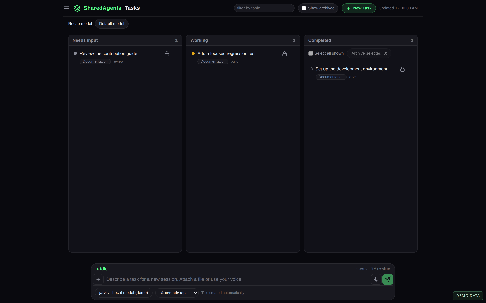

# SharedAgents

[](https://pypi.org/project/sharedagents/)
[](https://pypi.org/project/sharedagents/)
[](LICENSE)
[](https://github.com/sharedagents-ai/sharedagents/actions/workflows/ci.yml)

**Run AI agents on infrastructure you control, with inspectable conversations,
model calls, tool activity, and costs.**

SharedAgents combines a terminal interface, browser UI, agent orchestration,
and messaging channels in one Python distribution. Use a local model server
or a supported hosted provider. Conversation records and application state
live in your SharedAgents home; configured providers and integrations receive
the requests needed to do their work.

## Get started

Python 3.10–3.14 is supported. The optional WhatsApp channel requires Python
3.11 or newer.

```bash
pip install "sharedagents[web]"
sharedagents
```

The first-run wizard configures your model endpoint and agent. For a configured
installation, the foreground stack launcher runs the orchestrator, gateway,
and browser UI together:

```bash
python -m sharedagents.serve
```

The browser UI uses `http://127.0.0.1:8110`. The launcher requires its component
ports to be free; see the [installation guide](docs/getting-started/installation.md)
for setup and the [deployment guide](docs/guides/deployment.md) for containers,
login creation, and service management.

## What is included

- Terminal and browser interfaces for conversations, agents, models, usage,
  tasks, and voice.
- Agent execution with tool permissions, delegation, cancellation, and
  persistent session records.
- Pluggable model providers and engine adapters, with MCP tools and ACP
  integration.
- Local Markdown memory with a rebuildable SQLite search index.
- Optional Telegram and WhatsApp channels, speech services, and an inference
  replica router.

Agents can execute commands and access files through their configured tools.
Review [configuration](docs/getting-started/configuration.md) and
[security](SECURITY.md) before enabling integrations or exposing a service.



*The shipped browser interface with isolated demo data. Explore the
[interface tour](docs/getting-started/interface-tour.md) for desktop and mobile views.*

## Optional components

Install only the components you need, for example `pip install "sharedagents[web,stt]"`.

| Extra | Adds |
| --- | --- |
| `web` | Browser UI and HTTP server dependencies |
| `full` | Document conversion, web extraction, YouTube, and media tools |
| `stt` | Local CPU speech-to-text with Faster Whisper |
| `bedrock` | Native Amazon Bedrock Converse transport |
| `whatsapp` | Linked-device self-chat channel; needs system libmagic |
| `realtime` | Realtime voice server dependencies |
| `vllm-router` | Optional local inference replica router |

Wake-word models are an explicit download with separate license terms; see
[voice models](docs/guides/voice-models.md). Push-to-talk is available without them.

## Documentation

| Start here | Reference and integrations |
| --- | --- |
| [Installation](docs/getting-started/installation.md) | [Sampling](docs/guides/sampling.md) and [model parameters](docs/guides/model-parameters.md) |
| [Configuration and runtime files](docs/getting-started/configuration.md) | [Amazon Bedrock](docs/guides/bedrock.md) |
| [Interface tour](docs/getting-started/interface-tour.md) | [Contributing](CONTRIBUTING.md) |
| [Deployment](docs/guides/deployment.md) | [WhatsApp](docs/guides/whatsapp.md) and [voice](docs/guides/voice-models.md) |
| [Troubleshooting](docs/guides/troubleshooting.md) | [Memory maintenance](docs/guides/memory.md) |
| [Architecture and package map](docs/development/architecture.md) | [Delegation](docs/guides/delegation-waves.md) and [research](docs/guides/research-workflow.md) |

All documentation is versioned in this repository. To build it locally, install
the `docs` extra and run `mkdocs build --strict`; see
[development setup](docs/development/setup.md).

## Repository layout

```text
.github/        Issue templates, review ownership, and CI
docs/           Getting started, usage guides, and development docs
examples/       Generic configuration examples without credentials
scripts/        Maintainer and repository utilities
src/            Installable sharedagents and sharedagents_* packages
tests/          Automated tests and sanitized fixtures
website/        Public landing page and documentation build
pyproject.toml  Package metadata, extras, and tool configuration
```

The Python `src/` layout keeps installed code separate from repository tooling.
The [package map](docs/development/architecture.md#package-ownership) explains
which package owns each subsystem and where a contribution belongs.

## Contribute

Start with [CONTRIBUTING.md](CONTRIBUTING.md), then follow the
[development setup](docs/development/setup.md) and [testing guide](docs/development/testing.md).
Small bug fixes, documentation improvements, and reproducible issue reports
are welcome. Larger interface or dependency changes should begin with an issue.

- [Support and questions](SUPPORT.md)
- [Project governance](GOVERNANCE.md)
- [Code of conduct](CODE_OF_CONDUCT.md)
- [Security reporting](SECURITY.md)
- [Changelog](CHANGELOG.md) and [release process](RELEASES.md)

## License

SharedAgents is [MIT licensed](LICENSE). Bundled third-party code and assets
retain their notices. Optional runtime downloads may use different licenses;
see [third-party licenses](THIRD_PARTY_LICENSES.md).
