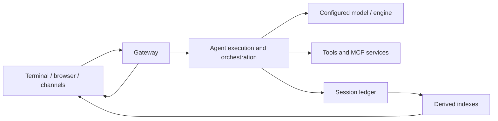

# Architecture and repository map

SharedAgents is one Python distribution with a `src/` layout and several
top-level packages. Packages separate subsystem ownership while keeping a
single installation and release process. Browser assets live with their Python
package so a wheel installation has the same UI files as a source checkout.

## Repository boundaries

| Path | Purpose |
| --- | --- |
| `src/` | Installable Python packages and required runtime assets |
| `tests/` | Automated tests and small, sanitized fixtures |
| `docs/getting-started/` | Installation, configuration, and first-run guidance |
| `docs/guides/` | Feature, provider, and operator guides |
| `docs/development/` | Architecture, local setup, and verification |
| `examples/` | Generic, incomplete examples with no live credentials |
| `scripts/` | Repository checks and maintainer utilities |
| `.github/` | CI, issue templates, and pull-request guidance |

Build output, virtual environments, local worktrees, audit reports, deployment
settings, and application data are excluded from the public source tree.
`MANIFEST.in` and `pyproject.toml` separately define source-distribution and
wheel contents.

## Package ownership

| Package | Owns |
| --- | --- |
| `sharedagents` | Small cross-package launch entry points |
| `sharedagents_core` | Shared configuration, layout, compatibility, and common services |
| `sharedagents_agent` | Agent configuration, engines, turn execution, tools, and delegation |
| `sharedagents_orchestrator` | Turn coordination, execution telemetry, and session-tree views |
| `sharedagents_gateway` | Service lifecycle, ingress/control endpoints, streaming, and worker dispatch |
| `sharedagents_session` | Session events, ledger readers/writers, and derived SQLite indexes |
| `sharedagents_model` | Model declarations, provider metadata, pricing, and usage accounting |
| `sharedagents_command` | Slash-command vocabulary and dispatch |
| `sharedagents_skill` | Skill discovery and bundled skills |
| `sharedagents_mcp` | MCP client and bundled servers, including memory |
| `sharedagents_acp` | ACP client, server, protocol, and transports |
| `sharedagents_goal`, `sharedagents_loop` | Goal and recurring-loop coordination |
| `sharedagents_research` | Knowledge-store research workflow and typed client |
| `sharedagents_tui`, `sharedagents_web` | Terminal and browser interfaces |
| `sharedagents_telegram`, `sharedagents_whatsapp` | Messaging channels |
| `sharedagents_realtime` | Realtime voice sessions |
| `sharedagents_vllm` | Optional inference replica router |

Some compatibility facades re-export older entry points. Prefer the owning
module for new code. A cosmetic directory cleanup should not move stable
imports or turn a compatibility module into a second implementation.

## Request flow

The foreground stack launcher starts the orchestrator and gateway on separate
loopback ports and optionally serves the WebUI. Agent execution records events;
session readers and indexes support history and UI views. The memory service
is a builtin MCP capability: clients call its wire API, while its engine owns
Markdown writes and indexing.

## Data and trust boundaries

- Runtime home resolution is centralized in `sharedagents_core.kernel.layout`.
  Tests redirect that home and use disposable session stores.
- Credentials are runtime data. Model declarations reference named secrets;
  examples and defaults contain no live credentials.
- The WebUI authenticates users and applies account/session access checks.
  Gateway/orchestrator bindings and proxy trust require deliberate deployment
  configuration; see [SECURITY.md](../../SECURITY.md).
- Provider calls, external tools, and channels are explicit integrations that
  can send data off the machine. Local storage does not make those requests
  private from their selected provider.

## Extending the project

Start with the subsystem that owns the behavior. Preserve transport contracts,
configuration semantics, and installed-package assets when changing an interface.
Propose a new top-level package or heavy dependency in an issue before adding it.
Explain configuration/storage migrations and keep fixtures independent of a
maintainer's deployment. See [testing](testing.md) for verification by change type.
