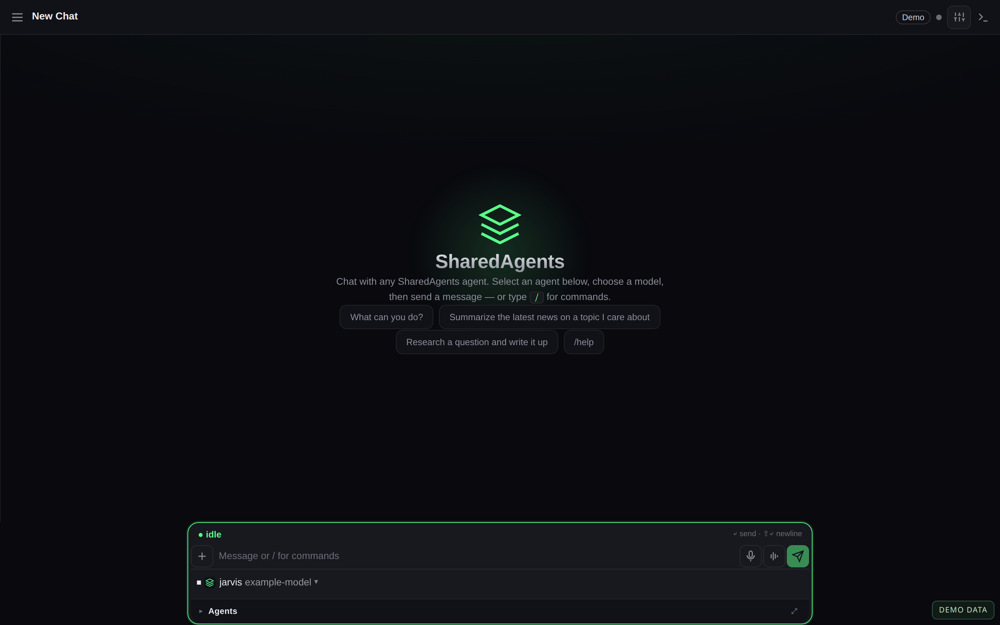
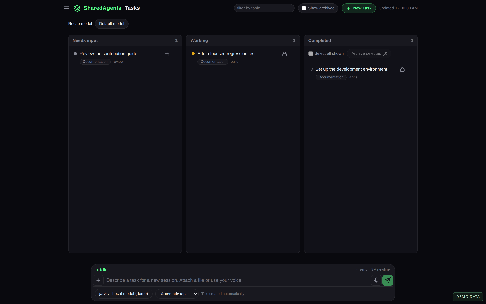
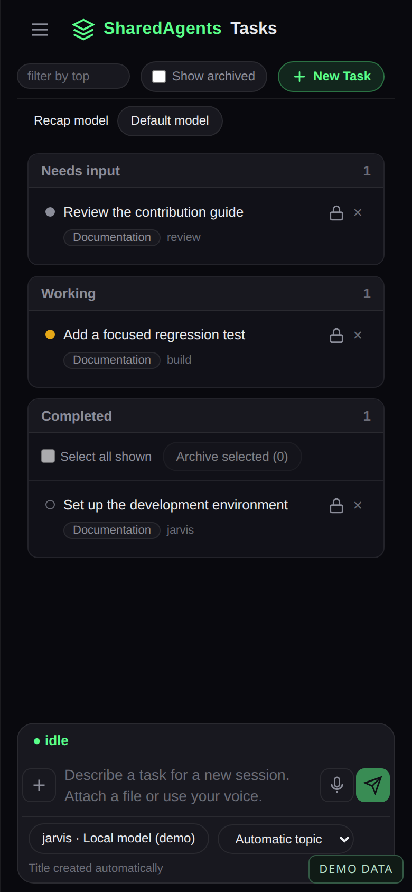
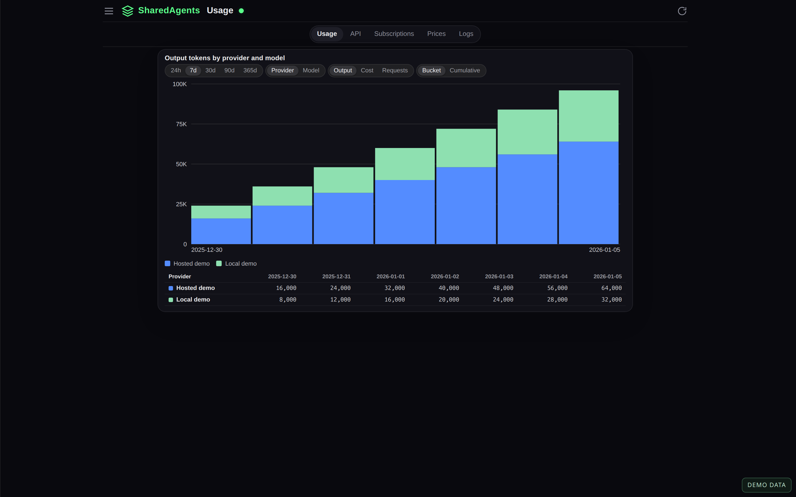
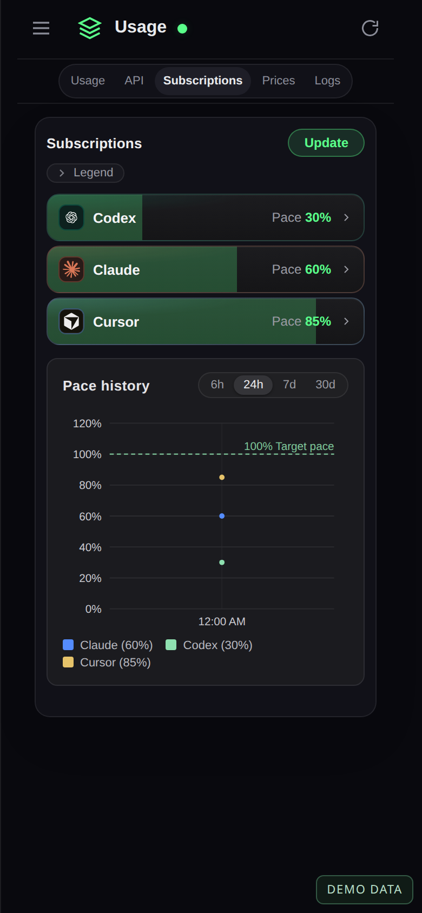
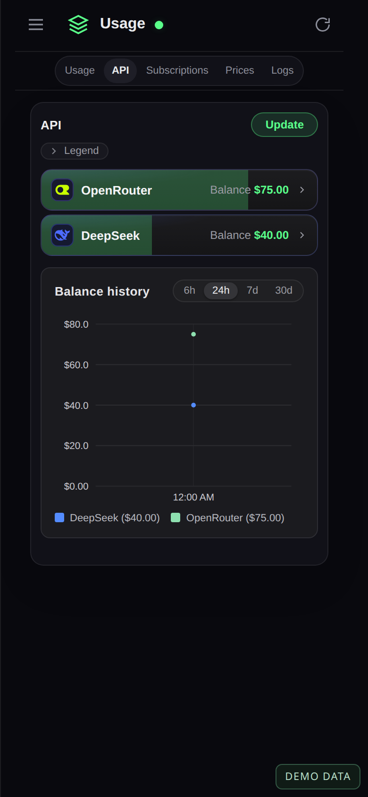
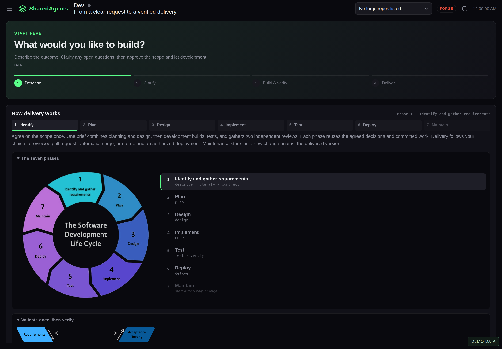

# Interface tour

SharedAgents offers a browser workspace alongside its terminal interface. The
screenshots below capture the shipped templates, styles, and JavaScript with
isolated **demo data**. Names, tasks, usage figures, and dates are illustrative;
they are not real conversations, account balances, or measured performance.

## Start a conversation

Choose an agent and model in the composer, describe your task, and send the first
message. Sessions preserve the conversation and its execution history. The
browser also accepts attachments and offers voice controls when those components
are configured.

Install the browser extra and complete the first-run wizard using the
[installation guide](installation.md). Configure your provider endpoint and
credentials in your private runtime environment, outside the source checkout.

## Follow tasks through the board

The task board groups sessions into **Needs input**, **Working**, and
**Completed**. Each row keeps the task title, topic, and agent visible. A session
that needs a response is easy to find while other work continues.

The same board adapts to a narrow screen:

{ width="390" }

## Inspect usage and provider status

The usage chart switches between provider and model grouping, output tokens,
cost, and requests. Change the time window or compare buckets with cumulative
activity. The chart below contains synthetic values from the capture fixture.

The **Subscriptions** and **API** tabs show provider quota or balance snapshots
when the relevant integration is configured. Availability depends on the
provider and credentials; a screenshot is not a promise of account access.

{ width="390" }

{ width="390" }

## Understand development delivery

The development view explains the stages from a clear request through planning,
implementation, verification, and delivery. Repository and forge integration
must be configured before working with a repository. The screenshot shows the
orientation view, with no connected private repositories.

## Make your first contribution

Start with the [development setup](../development/setup.md), find the relevant
package in the [architecture map](../development/architecture.md), and run the
checks described in the [testing guide](../development/testing.md). Small
documentation fixes and reproducible bug reports are useful contributions.

The capture script and fixtures are versioned with the project so contributors
can refresh these images without using personal account data. See
[capturing interface images](../development/setup.md#capture-interface-images).
