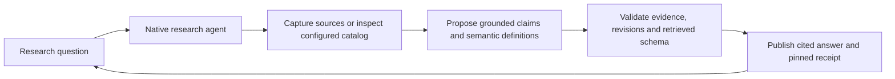

# Native research ontology

The native `research` agent accumulates evidence, entities, concepts, claims and
business definitions in a SharedData-backed ontology. A successful investigation
publishes a receipt that pins its sources, fact states, semantic revisions and
executed queries. Later research retrieves and extends that knowledge.

SharedAgents owns all extraction, meaning, reconciliation and governance logic.
SharedData supplies private transactional containers, text postings and supplied
vector storage. Neither the SDK nor the data worker calls a model.

## Installation and setup

The semantic model requires SharedData 6.103.0 with its `search` extra. **That SDK
version must be released before this feature's packaged installation/CI can be
delivered.** During coordinated development, install the SDK feature checkout
into a dedicated Python 3.11/3.12 environment, then install this checkout's
ontology dependencies. The lean SharedAgents core keeps its normal Python range.

After the SDK release:

```bash
pip install -e '.[ontology,web]'
python -m sharedagents_research setup --agent-home /path/to/runtime/agents/research
```

Setup installs the native research prompt/tools, preserves model routes and other
unrelated settings, and checks storage before replacing configuration. An operator
may select `--backend-python /path/to/sdk/bin/python`. This launches one awaited
operation in the SDK interpreter, using the same application code, without
passing model credentials or starting an unattended service.

The runtime `ontology` configuration accepts `root`, optional `python`, configured
`connections`, `workspaces` and `default_workspaces`. A connection contains an
operator-selected `url_env`, whose environment variable holds its database URL.
Models see connection names, never connection strings or credentials.

```json
{
  "ontology": {
    "connections": {
      "sales": {"url_env": "RESEARCH_SALES_URL", "scopes": ["workspace:team"]}
    },
    "workspaces": {"team": {"members": {"user@example.com": "editor"}}},
    "default_workspaces": {"user@example.com": "team"}
  }
}
```

Remote sources require `read_only_credentials: true` and an actually read-only
account. Optional extras install individual vendor drivers. SQLite and DuckDB
also enforce read-only opens; PostgreSQL uses a read-only transaction/deadline.
Other vendors rely on the configured database role. The native SQL validator is
an additional restriction, not a replacement for that role.

## Native workflow



| Native capability | Actions |
| --- | --- |
| `ontology_search` | Hybrid retrieval, objects, table contexts, coverage, paths, history, time, evidence paging and compilation status |
| `ontology_source` | Existing web fetch plus immutable evidence capture and optional embeddings |
| `ontology_update` | Begin, extract, compile, define/batch, import, guarded query and finish |

Research uses its configured native model and embedding resolver. There is no
second LLM agent loop in the ontology package. Every captured source must be
extracted before publication; irrelevant sources may have explicitly empty
extractions. Exact quoted spans establish attribution, not real-world truth.

A research turn cannot report success without a successful `finish`. Publication
failure gets two bounded continuations, then an incomplete/error result. A prose
claim that knowledge was saved is insufficient. Budget exits enforce the same
condition, and cancellation remains cancellation.

## Structured data and semantic compilation

`compile` snapshots actual configured tables/views, columns, declared keys and
bounded sample profiles. Suspected sensitive columns have their sample values
redacted. These are incomplete PII hints, not a comprehensive PII classifier.
The agent then refines table terms and creates attributed column meanings using
paginated `table` contexts and atomic `define_many` batches.

`compilation_status` reports missing descriptions/mappings. `draft_ready` means
mechanical coverage, **not semantic correctness or expert certification**.
Human review is separate. Recompilation preserves business terms and annotations;
changed physical snapshots lose their prior certification.

`compile` with `analyze: true` additionally discovers matching schema families,
junction-table candidates and likely foreign keys. Name similarity proposes an
inferred join; full-domain uniqueness/orphan queries decide whether to enable
it. Failures leave disabled drafts. Family similarity does not silently union
tables. Source changes invalidate affected old join validation.

An optional `query_history_env` points to an operator-selected JSON history
export. Valid read queries become draft analysis examples. Importing one neither
executes nor certifies it. Native research interprets its business meaning.

Retrieval pins accessible table context to the current run. SQL execution requires
one read-only query, known tables/columns, approved analytical functions, and
previously retrieved tables from the same configured connection. Successful
queries archive SQL, actual bounded rows, truncation and catalog revisions.
Native research defines metrics as semantic records and uses validated queries
to execute them; metadata alone is never proof of an executed metric.

## Evidence, conflict and time

Entities and concepts keep stable provisional identities and immutable,
source/model-attributed definition proposals. Scalar facts distinguish unit,
period and basis. Multi-valued object relations distinguish their targets and
modality, so two different valid targets are not automatically contradictions.
Different active values for the same fact remain contested.

An explicit correction requires changed content, a strictly later verified source
time, and the same attributed publisher and fact. Corrections arriving before
originals are held pending. Shared hosting sites do not collapse every account
into one publisher. Model-proposed dates from arbitrary web pages remain
unverified and cannot establish correction precedence. Exact syndicated copies
count once as independent content.

Event and publication timelines are separate, use UTC and preserve ties. Unknown
event time is never invented from publication or ingestion time. State summaries
have bounded examples and exact counts; `fact_evidence` pages all retained claims
at either current or pinned historical revisions. Updating a popular fact does
not copy an ever-growing evidence array into every new state.

This policy preserves disagreements and accepts validated explicit corrections.
It does not establish truth by majority, latest arrival or an unsupported model
assertion. General validity intervals and reviewed semantic entailment remain
separate evaluation work.

## Authenticated exploration and interoperability

The `/ontology` page uses existing authentication. Users can inspect/search
objects, mappings and revisions, edit drafts, and certify or retire permitted
records. Workspace roles are viewer, editor, reviewer and owner; agents do not
receive the human certification capability. Revision checks reject stale edits.
Edits invalidate old vectors atomically; lexical retrieval stays available.
Automatic re-embedding after a human edit is not yet a background maintenance
feature; the native definition/import path embeds changed objects when configured.

The authenticated `/api/ontology` exposes inspection, history, coverage, paths,
native/NVIDIA/Ossie export, draft imports and governed writes. Stored query IDs
can be rendered as portable Vega-Lite specifications (`action=chart`) or downloaded
as formula-safe CSV (`action=csv`). These use archived results without rerunning
SQL. A full interactive chart/chat analysis workbench remains separate work.

`POST /api/ontology/research` submits the existing native research agent, with
its usual agent grant and authenticated actor. Native research uses the actor's
configured default workspace; the endpoint rejects a conflicting workspace.

Run `python -m sharedagents_research.mcp` for authenticated stdio MCP access.
Configure `SHAREDAGENTS_RESEARCH_API_URL` and a user API token in
`SHAREDAGENTS_RESEARCH_API_TOKEN`. The MCP client uses the same HTTP authorization
and waits for stored publication receipts. It does not expose a second public
server or direct unscoped filesystem access.

NVIDIA native-format export/import is implemented. Optional Ossie conversion
uses the official Apache converter's public API, not a lookalike YAML format.
Install that converter separately from
[Apache Ossie converters](https://github.com/apache/ossie-converters/tree/main/nvidia).
Imports remain drafts and imported joins stay disabled pending validation.
Round trips of supported fields are not a claim of preserving every vendor field.

## Foreground execution and boundaries

```bash
python -m sharedagents_research research 'Compare the evidence for this topic'
python -m sharedagents_research research 'Research these sources' \
  --source https://example.com/one --source https://example.com/two --parallel 8
python -m sharedagents_research inspect --root /path/to/ontology --query capacity
```

The coordinator awaits all native sessions, limits concurrency to 1..32 and awaits
cancellation cleanup. It never delegates through agent tools. Stores are private
by default and initialized empty; models cannot choose paths or user scopes.
Legacy `KnowledgeClient`/`ResearchWorkflow` imports remain available independently.

See [the capability ledger](../development/ontology-parity.md) for implementation
and evaluation gaps. A working example, a cached-news storage replay, or a passing
SQL question alone does not establish full NVIDIA product parity or superiority.
