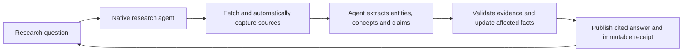

# Native research ontology

The native `research` agent automatically accumulates fetched evidence, entities,
concepts and claims in a SharedData-backed ontology. Each completed investigation
publishes an immutable answer receipt. Later investigations search that accumulated
knowledge and extend it.

From an updated checkout, install the optional data-layer dependency in the
interpreter running the tools:

```bash
pip install -e '.[ontology]'
```

The current SharedData distribution supports Python 3.11 and 3.12. Other
SharedAgents features retain their normal Python requirements. Missing SharedData
is an explicit tool error; there is no alternate storage fallback.

An operator can instead select an existing SDK interpreter with
`setup --backend-python /path/to/sdk/bin/python`. Only awaited data operations run
there, using the same SharedAgents ontology code and SharedData container. Model
reasoning stays in the native research runtime. The worker receives no provider
credentials and creates no service or background job.

## Workflow



Three native tools implement this workflow:

| Tool | Behavior |
| --- | --- |
| `ontology_search` | Readiness, indexed lexical search, objects, definitions/facts, event timeline and publication history |
| `ontology_source` | Fetch a source using the existing web-fetch implementation and persist exactly its returned evidence |
| `ontology_update` | Begin the current turn's research run, submit grounded structured extractions and publish its answer |

The native runtime requires a successful `finish` operation before reporting a
research turn as successful. If publication fails, it gives the agent two bounded
continuations, then reports an incomplete/error outcome. A model's prose assertion
that it saved knowledge does not satisfy the gate. Budget and round-limit exits
also enforce this condition; cancellation remains cancellation.

A captured source must be processed before the answer can be published. Empty
extractions can represent irrelevant content; the research agent is responsible
for semantic completeness. Grounding checks require source quotes and save the
actual contiguous source span, accepting line wrapping but rejecting paraphrases.
These checks establish attribution, not independently verified truth.

## Storage, identity and time

SharedAgents owns ontology policies. SharedData owns the generic private SQLite
container, indexed access and operation-scoped transactions. Research never calls
a model inside SharedData. No PostgreSQL service is required by this research
path.

Authenticated restricted users receive namespaces derived from their pinned
access identity. The local operator uses the operator namespace. Models cannot
supply another user's scope or a destination filesystem path. The three native
ontology capabilities access only this application-owned state; host file and
shell tools keep their existing confinement. API callers coordinating research
must pass the authenticated `AccessStamp` to `research_many`.

Entities and concepts have stable provisional identities. Source-backed definition
proposals remain separate from those identities; a newer description cannot
replace an older definition silently. Claims carry the originating source,
model route, prompt version, unit, period and basis. Different values for the same
fact remain contested. A correction must reference an earlier same-publisher
claim for the same dimensions. Exact syndicated copies do not count as independent
content. These are explicit policies, not automatic real-world truth adjudication.

Event timestamps determine the timeline. Equal event timestamps retain uncertain
ordering. Unknown event time is not filled with ingestion time. Publication and
capture times remain separate. Current fact updates use indexed affected-fact
lookups; the system does not recompute every fact on each source arrival. Published
answer receipts pin the fact states relevant to that investigation.

The current reducer treats each property as single-valued within its unit, period
and basis. Different values therefore remain contested unless an explicit valid
correction supersedes them. Additive relationships and time-varying properties
need richer cardinality and validity-interval policies. Event order alone does
not establish that one statement corrects another. A heavily updated fact also
retains growing evidence snapshots; large-corpus storage and latency remain to
be measured before claiming production-scale efficiency.

## Run and inspect

The normal research chat uses these tools. A foreground application entry point
is also available:

```bash
python -m sharedagents_research research 'Compare the evidence for this topic'
python -m sharedagents_research research 'Research the supplied sources' \
  --source https://example.com/one --source https://example.com/two --parallel 8
python -m sharedagents_research inspect --root /path/to/ontology --query capacity
```

Parallel source briefs run through native research sessions using the configured
agent and model. The coordinator awaits every worker and propagates cancellation;
workers have no delegation tools. The limit is configurable from 1 to 32.

The default root is the runtime home's `ontology/` folder. An operator can supply
`SHAREDAGENTS_ONTOLOGY_ROOT` at runtime. New stores start empty. Source deletion or
import from another knowledge system is not part of initialization.

Existing installations can explicitly install the new local research prompt and
tool configuration after installing the updated package and its ontology extra:

```bash
python -m sharedagents_research setup --agent-home /path/to/runtime/agents/research
```

This replaces that agent's prompt and tool/skill lists, preserving unrelated
settings such as configured model routes. It verifies the SDK can initialize the
store before writing configuration. The native research profile does not expose
shell or file-editing tools. Existing `KnowledgeClient` and `ResearchWorkflow`
imports remain available for applications using a separately configured legacy
knowledge MCP backend; new native research uses the ontology path above.

## Capability boundaries

This implementation supplies the native research accumulation loop. Lexical
retrieval, provisional definitions, evidence-backed claims, conflict retention and
historical answer receipts are implemented. Semantic vector retrieval, database
schema compilation/connectors, executable SQL metrics, governance/editor UI,
Ossie interchange, prediction integration and full NVIDIA API/MCP compatibility
remain tracked in [the parity plan](../development/ontology-parity.md). Passing a
small example does not establish full product parity or a throughput advantage.
